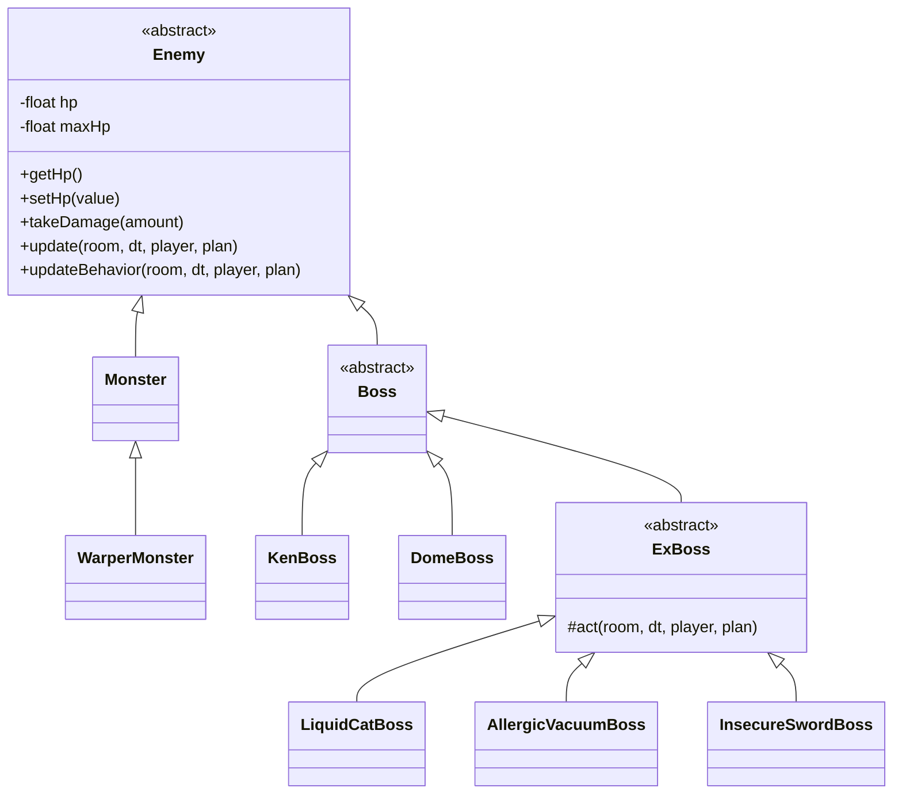

# คู่มือพรีเซนต์ OOP จากโค้ดเกมจริง

อัปเดต 14 ตุลาคม 2026 — ใช้โค้ดปัจจุบันในโปรเจกต์นี้เป็นหลัก

## 1. สิ่งที่เปลี่ยนและขอบเขตของงาน

- Java ฝั่งเกมหลัก **51 ไฟล์**: หลังลดชั้น Behavior เหลือ 48 ไฟล์ ได้เพิ่ม 3 คลาสแยกหน้าที่การวาดจาก GameRenderer
- `CombatRoom` มี **250 บรรทัด**; ก่อนแยก `Enemy` ในรอบก่อนหน้ามี 378 บรรทัด
- เอาคลาส AI แบบ `Behavior` ของศัตรูออก แล้วให้คลาสศัตรู Override พฤติกรรมของตัวเอง
- เลือดศัตรูเป็น `private`; อ่านผ่าน Getter เปลี่ยนผ่าน Setter และเมธอดรับดาเมจ
- ไม่ใช้ HashMap หรือ Map ในโค้ดเกมหลัก
- บอสปกติที่เปิดใช้งาน: **Ken, Ae, M, Sati, Dome**
- EX: **Liquid Cat, Allergic Vacuum, Insecure Sword**
- Far ถูกถอดออก; `FINAL_EXAM` เหลือ **Ae กับ Dome** ที่ตู้ด้านซ้ายและขวา

อย่าอธิบายว่า “ไฟล์น้อย = OOP” ให้ชี้ว่า **ใครเป็นเจ้าของข้อมูล ใครรับผิดชอบพฤติกรรม และระบบอื่นเรียกผ่านอะไร**

## 2. โครงสร้างคลาสศัตรู



`AeBoss`, `MBoss` และ `SatiBoss` สืบทอดจาก `Boss` เช่นเดียวกับ Ken และ Dome

| คลาส | รับผิดชอบอะไร | เหตุผลที่มีคลาสนี้ |
| --- | --- | --- |
| `Enemy` | เลือด ตำแหน่ง สถานะผิดปกติ ขอบเขตชน และลำดับอัปเดตพื้นฐาน | มอนกับบอสใช้กติกาพื้นฐานร่วมกัน |
| `Monster` | การเดิน/โจมตีทั่วไป อัตราฟื้น SP และชนิดภาพของมอน | มอนที่ต่างเพียงค่าสถานะหรือภาพใช้คลาสเดียวได้ |
| `WarperMonster` | การเตือนจุดและวาร์ปโจมตี | พฤติกรรมต่างจากมอนทั่วไป จึง Override `tryWarp()` |
| `Boss` | ฟื้น SP แบบบอส อยู่ประจำที่ และกติกาวาร์ปร่วม | บอสปกติและ EX เป็นศัตรูประเภทบอสเหมือนกัน |
| บอสปกติแต่ละตัว | สกิล ตัวจับเวลา และข้อมูลเฉพาะตัว | เปิดไฟล์บอสแล้วตามสกิลของตัวนั้นได้ |
| `ExBoss` | สถานะเตือน/พัก การเคลื่อนที่และขอบสนามร่วมของ EX | EX ทั้งสามใช้ลำดับนี้ร่วมกัน แต่โจมตีต่างกัน |
| EX แต่ละตัว | เฟส แยกร่าง ดูดฝุ่น หรือความมั่นใจของดาบ | Override `act()` และกติกาเฉพาะตัว |

`Enemy`, `Boss` และ `ExBoss` เป็น abstract class สำหรับชนิดแม่ การสร้างศัตรูจริงใช้คลาสลูก เช่น AeBoss หรือ DomeBoss แม้ Boss จะมีพฤติกรรมร่วมที่เขียนไว้แล้ว ก็ยังประกาศ abstract ได้เพื่อให้การสร้าง Object ระบุชนิดบอสที่ชัดเจน

## 3. เชื่อมกับบทเรียนทุกหัวข้อที่ส่งมา

| บทเรียน | Concept | ตัวอย่างในเกม |
| --- | --- | --- |
| L01 Java, Class, Object | Class เป็นแบบของ Object; แต่ละ Object มีสถานะของตัวเอง | `new KenBoss(...)`, `new DomeBoss(...)`; เลือดของแต่ละตัวแยกกัน |
| L02 Field, Method, Constructor | Field เก็บข้อมูล, Method ทำงานกับข้อมูล, Constructor เตรียมสถานะเริ่มต้น | `Enemy` เก็บ HP; `takeDamage()` ลด HP; constructor กำหนด HP/SP/ตำแหน่ง |
| L03 Abstraction & Getter | เปิดการใช้งานที่จำเป็นและซ่อนรายละเอียดภายใน | `getHp()` อ่านเลือดโดยเข้าถึง field โดยตรงไม่ได้; ห้องเรียก `enemy.update(...)` |
| L04 Setter, Static, Final | Setter ควบคุมค่า; static เป็นของคลาส; final ป้องกันกำหนดค่าใหม่ | `setHp()` จำกัดค่า; ID/เวลาสกิลเป็นค่าคงที่; `maxHp` เป็น final ประจำศัตรูแต่ละตัว |
| L05 OO Inheritance | extends, super, protected, Overload, Override | `WarperMonster extends Monster`; `super.updateBehavior(...)`; constructor และ `damageArc()` มีหลาย signature |
| L06 Polymorphism | เรียกผ่านชนิดแม่แล้วทำงานตาม Object จริง; abstract class และ interface | ห้องเก็บ `Enemy`; อาวุธเก็บเป็น `WeaponAttack`; renderer เก็บเป็น `EnemySprite` |
| L10 SOLID | แบ่งหน้าที่ ใช้สัญญาร่วม และขยายพฤติกรรม | ดูตาราง SOLID ในหัวข้อ 7 |
| L11 Design patterns | เลือกรูปแบบให้ตรงปัญหา | `EnemyFactory` ใช้ Simple Factory; บทเรียน Adapter/Chain of Responsibility ไม่ได้ถูกใส่เพิ่มเพื่อให้ครบชื่อ |

## 4. ตัวอย่างสำคัญที่ควรเปิดโค้ดให้ดู

### A. Class, field, constructor และ Encapsulation

เปิด [Enemy.java](D:/oop-game-school-life/project-school-action-roguelike-state/core/src/main/java/io/github/kirinojuju/enemy/Enemy.java:14)

โค้ดส่วนสำคัญ:

```java
private float hp;
private final float maxHp;

public float getHp() { return hp; }
public float getMaxHp() { return maxHp; }
public void setHp(float value) { hp = MathUtils.clamp(value, 0, maxHp); }
public void takeDamage(float amount) { setHp(hp - Math.max(0, amount)); }
```

อธิบายว่า: “ตัวศัตรูเป็นเจ้าของเลือด ระบบอื่นอ่านผ่าน Getter และเปลี่ยนผ่านเมธอดที่กำหนด เลือดจึงไม่ต่ำกว่า 0 หรือเกิน max HP จาก Setter นี้ และดาเมจติดลบไม่กลายเป็นการฮีล”

`maxHp` ไม่ใช่ static: บอสแต่ละตัวมี max HP ต่างกันได้ แต่หลังสร้างตัวนั้นแล้วค่าเดิมไม่ถูกเปลี่ยน

### B. Inheritance และ Override

เปิด [Monster.java](D:/oop-game-school-life/project-school-action-roguelike-state/core/src/main/java/io/github/kirinojuju/enemy/Monster.java:8) แล้วเปิด [WarperMonster.java](D:/oop-game-school-life/project-school-action-roguelike-state/core/src/main/java/io/github/kirinojuju/enemy/WarperMonster.java:10)

- `Monster` รับข้อมูลและลำดับการอัปเดตมาจาก `Enemy`
- `WarperMonster` รับการทำงานทั่วไปมาจาก `Monster` แล้ว Override `tryWarp()`
- ไม่ต้องเขียน HP, poison, slow และการฟื้น SP ซ้ำทุกคลาส
- มอนที่ต่างแค่ภาพ/ค่าสถานะใช้ `Monster` กับข้อมูลชนิดมอน พฤติกรรมวาร์ปมีคลาสลูกเพราะมี Logic ต่างจริง

เปิด [KenBoss.java](D:/oop-game-school-life/project-school-action-roguelike-state/core/src/main/java/io/github/kirinojuju/enemy/boss/KenBoss.java:96): Ken อัปเดตระเบิดของตัวเอง แล้วเรียก `super.updateBehavior(...)` เพื่อใช้พฤติกรรมร่วมของบอสต่อ

### C. Polymorphism ในห้องต่อสู้

เปิด [CombatRoom.java](D:/oop-game-school-life/project-school-action-roguelike-state/core/src/main/java/io/github/kirinojuju/combat/CombatRoom.java:205)

ห้องเรียกศัตรูด้วยรูปแบบเดียวกัน:

```java
for (Enemy enemy : enemies) enemy.update(this, dt, player, plan);
```

`Enemy.update()` กำหนดลำดับกลาง: พิษ → ตัวจับเวลา → ฟื้น SP → เรียกพฤติกรรม → ตรวจการเคลื่อนผ่าน Ice Wall

ภายในลำดับนั้น Java เลือก `spRecovery()`, `updateTimers()` และ `updateBehavior()` ตามคลาสจริง เช่น Monster, Ken หรือ Dome โดย `CombatRoom` ไม่ต้องเขียนเงื่อนไขแยกชื่อบอสทุกตัว

ข้อควรพูดให้ถูก: `update()` เป็น final จึงไม่ได้ถูก Override; **เมธอดที่มันเรียกภายใน** เป็นจุดที่คลาสลูก Override

### D. Abstract class กับ EX หลายแบบ

เปิด [ExBoss.java](D:/oop-game-school-life/project-school-action-roguelike-state/core/src/main/java/io/github/kirinojuju/enemy/ex/ExBoss.java:12)

`ExBoss.updateBehavior()` จัดกติกาที่ใช้ร่วมกัน: หยุดเมื่อ stun → เรียก `act()` → จำกัดขอบสนาม ส่วน `act()` เป็น abstract ให้ EX แต่ละตัวเติมการโจมตี

เปิด [LiquidCatBoss.java](D:/oop-game-school-life/project-school-action-roguelike-state/core/src/main/java/io/github/kirinojuju/enemy/ex/LiquidCatBoss.java:53)

- Override `act()` สำหรับ Orbital การเดิน และ Divide
- Override `damageMultiplier()` เพื่อป้องกันดาเมจระหว่าง Transform และลดดาเมจในเฟส 2
- Override `onDefeated()` เพื่อเปลี่ยนเฟสเมื่อจบเฟสแรก และลบร่างแยกเมื่อชนะตัวหลัก
- `CombatRoom` เรียก `onDefeated()` ก่อนลบศัตรู จึงรองรับบอสหลายเฟสโดยไม่ต้องรู้ชื่อ Cat

### E. Interface, implements และ Dependency injection

เปิด [WeaponAttack.java](D:/oop-game-school-life/project-school-action-roguelike-state/core/src/main/java/io/github/kirinojuju/weapon/WeaponAttack.java:10)

```java
public interface WeaponAttack {
    boolean attack(PlayerCharacter player, CombatRoom combat, GameAudio audio);
    void addAbility(WeaponAbility ability);
}
```

`AbstractWeaponAttack implements WeaponAttack` เก็บการลงทะเบียน Ability ร่วมกัน ส่วน `LanWeaponAttack` กับ `NotebookWeaponAttack` สืบทอดจากคลาสนี้ จึงเป็น implementation ของ interface ผ่านการสืบทอด

เปิด [PlayerCharacter.java](D:/oop-game-school-life/project-school-action-roguelike-state/core/src/main/java/io/github/kirinojuju/player/PlayerCharacter.java:62)

```java
public PlayerCharacter(WeaponAttack physical, WeaponAttack magical) {
    if (physical == null || magical == null)
        throw new IllegalArgumentException("Both weapon attacks are required");
    attacks = new WeaponAttack[] {physical, magical};
}
```

ตัวเกมส่ง implementation เข้ามาจาก [schoolLife.newRun()](D:/oop-game-school-life/project-school-action-roguelike-state/core/src/main/java/io/github/kirinojuju/schoolLife.java:44)

อธิบายว่า: “ผู้เล่นเรียกผ่าน `WeaponAttack` และรับ Object ทาง constructor จึงเปลี่ยน implementation หรือทดสอบด้วยอาวุธจำลองได้ โดยไม่แก้เมธอดโจมตีของผู้เล่น”

constructor แบบไม่มีพารามิเตอร์ยังเตรียมอาวุธค่าเริ่มต้นให้สะดวก จึงยังมีการอ้าง concrete class ในส่วนประกอบค่าเริ่มต้น ไม่ควรพูดว่าทั้งโปรเจกต์ไม่มี dependency ต่อ concrete class

### F. Overload กับ Override ต่างกัน

| หัวข้อ | Overload | Override |
| --- | --- | --- |
| ลักษณะ | ชื่อเดียวกัน แต่จำนวนหรือชนิดพารามิเตอร์ต่างกัน | เมธอดของคลาสลูกใช้ signature เดียวกับเมธอดที่สืบทอดมา |
| ตัวอย่าง | `PlayerCharacter()` กับ `PlayerCharacter(WeaponAttack, WeaponAttack)` | `WarperMonster.tryWarp()` หรือ `LiquidCatBoss.onDefeated()` |
| ใช้ทำอะไร | ให้ผู้เรียกเลือกวิธีส่งข้อมูล | ให้ Object แต่ละชนิดมีพฤติกรรมต่างกันผ่านสัญญาร่วม |
| หมายเหตุ | Constructor มี Overload ได้ | Constructor ไม่ถูกสืบทอดและไม่ถูก Override; ใช้ `super(...)` เรียก constructor แม่ |

ตัวอย่าง Method Overload อีกจุดคือ [CombatRoom.damageArc()](D:/oop-game-school-life/project-school-action-roguelike-state/core/src/main/java/io/github/kirinojuju/combat/CombatRoom.java:142): แบบพื้นฐานกับแบบที่รับ slow/tether เพิ่ม

## 5. static และ final ที่ควรอธิบาย

| ตัวอย่าง | เหตุผล |
| --- | --- |
| `RunPlan.AE_ID` และ `DomeBoss.LASER_FIRE` | ค่าคงที่ร่วม ไม่ต้องมีสำเนาของค่าที่เปลี่ยนได้ในบอสทุกตัว |
| `RunPlan.bossName(int)` | แปลง ID เป็นชื่อด้วย switch โดยไม่ขึ้นกับลูปของ Object ใด |
| `RunPlan.bossName()` | ใช้บอสของด่านปัจจุบันใน Object นี้ จึงเป็น instance method |
| `Enemy.maxHp` เป็น private final | ค่าประจำศัตรูตัวนั้นกำหนดตอนสร้าง แล้วไม่เปลี่ยน |
| `Enemy.update()` เป็น final | รักษาลำดับกลาง แล้วเปิดเฉพาะจุดที่คลาสลูกต้องปรับ |
| `PlayerCharacter.attacks` เป็น final reference | ไม่เปลี่ยนไปใช้อาร์เรย์อื่นหลังสร้าง ไม่ได้แปลว่า Object ภายในอาร์เรย์เปลี่ยนสถานะไม่ได้ |

static ไม่ได้แปลว่า “ไม่ใช่ OOP” และการใช้ final กับข้อมูลประจำ Object ไม่ได้ทำให้ข้อมูลนั้นใช้ร่วมกันทุก Object

## 6. ความสัมพันธ์แบบ has-a และ is-a

- `WarperMonster` **is-a** `Monster`; `LiquidCatBoss` **is-a** `ExBoss` และ **is-a** `Boss`/`Enemy`
- `PlayerCharacter` **has-a** ชุด `WeaponAttack` และ `PotionInventory`
- `CombatRoom` **has-a** `CombatDamage`, `ProjectileSystem`, `RoomObstacles` และ `IceWall`
- Renderer แต่ละตัวเป็นเจ้าของ texture ของตัวเอง และคืนทรัพยากรผ่าน `dispose()`

ใช้ extends เมื่อความสัมพันธ์เป็นชนิดย่อยจริง ส่วนอาวุธกับผู้เล่นใช้การประกอบ Object เข้าด้วยกัน เพราะอาวุธเป็นสิ่งที่ผู้เล่นมี

## 7. SOLID ที่ชี้จากโค้ดได้จริง

| หลัก | จุดที่ใช้ | ขอบเขตที่ควรพูดให้ตรง |
| --- | --- | --- |
| SRP | ห้องประสานงาน; ศัตรูดูแลพฤติกรรม; `CombatDamage` คำนวณดาเมจ; `ProjectileSystem` เดินกระสุน; GameRenderer ประสาน SceneRenderer/CombatRenderer/GameHud | แยกเจ้าของงานชัดขึ้น แต่ Player ยังมีหลายหน้าที่ |
| OCP | เพิ่มคลาสลูกแล้ว Override สกิล ห้องยังเรียก `Enemy` เหมือนเดิม; Ability ต่ออาวุธผ่าน interface | ยังต้องลงทะเบียนใน Factory/Renderer และอาจเพิ่มข้อมูลขนาดภาพ ไม่ใช่ว่าเพิ่มบอสแล้วไม่แก้ไฟล์เดิมเลย |
| LSP | มอน/บอสใช้ใน `Array<Enemy>` และผ่านลำดับ update เดียวกัน; ระบบใช้กติกาดาเมจ/การตายร่วม | Cat เปลี่ยนเฟสผ่าน hook ที่ห้องรองรับ ต้องรักษาสัญญานี้เมื่อเพิ่มบอส |
| ISP | `WeaponAttack`, `WeaponAbility`, `Disposable` มีหน้าที่เฉพาะ | ไม่สร้าง interface กลางที่บังคับมอนทุกตัวต้องมีท่าบอสหรือระบบเสียง/ภาพทั้งหมด |
| DIP | ผู้เล่นเก็บ `WeaponAttack` และรับ implementation ทาง constructor; renderer เรียก `EnemySprite` | รองรับการทำงานผ่าน abstraction; การสร้างค่าเริ่มต้นและบางระบบยังอ้าง concrete class จึงไม่อ้างว่าเป็น DIP ทั้งโปรเจกต์ |

**ยังมีข้อจำกัด:** พิกัด สถานะชน และตัวจับเวลาบางส่วนยังเป็น public เพื่อใช้ร่วมกับฟิสิกส์/ภาพ เลือดศัตรูถูกปิดการเข้าถึงแล้ว แต่ไม่ควรอ้างว่าทุก field ถูก encapsulate ครบ

## 8. Design patterns จากสไลด์ L11

**ใช้จริง: Simple Factory** — [EnemyFactory.java](D:/oop-game-school-life/project-school-action-roguelike-state/core/src/main/java/io/github/kirinojuju/enemy/EnemyFactory.java:166) เลือกสร้าง Object จาก ID แล้วคืนเป็น `Enemy`/`Boss` ห้องไม่ต้องรู้รายละเอียด constructor ของบอสทุกตัว การใช้ switch ในจุดประกอบ Object นี้ตรงกับตัวอย่าง factory ที่เรียน

**Adapter:** ตัวเปิดเกมสืบทอด `ApplicationAdapter` ของ libGDX เพื่อ Override lifecycle เช่น `create()` และ `render()` แต่ไม่ได้เขียน Adapter แปลง interface สองระบบเอง จึงไม่ใช้ชื่อนี้เป็นหลักฐานว่าทำ GoF Adapter ตามตัวอย่าง Xpay/PayD ครบ

**Chain of Responsibility:** ยังไม่ได้ใช้เป็นโครงสร้างรับคำขอแล้วส่งต่อ handler ตัวถัดไป การเรียกอัปเดตหลายระบบตามลำดับ หรือวนเลือก Sprite ไม่เพียงพอที่จะอ้างว่าได้ทำ pattern นี้ตามสไลด์

**การเลือก implementation ของอาวุธผ่าน interface** เป็นตัวอย่าง Strategy ที่สัมพันธ์กับ OCP ใน L10 เพิ่มเติมได้ แต่หัวข้อ L11 ที่ใช้เป็นหลักฐานตรงที่สุดคือ Factory

## 9. ลำดับเกมและวิธีเดโม

```text
ปก → ทางเข้าอาคาร → ห้องมอน → ห้องบอส → เลือกอัปเกรด
ครบ 4 ด่านใน Loop 1 → EX → Cutscene → FINAL_EXAM (Ae + Dome) → Loop ถัดไป
```

FINAL_EXAM เปิดหนึ่งครั้งต่อรันเมื่อชนะ Ae และ Dome ครบ โดย EX แรกต้องมาก่อน ผู้เล่นเดิน/Dash ซ้าย–ขวาในเลนล่าง บอสอยู่บนตู้ และ Dome ยิงเลเซอร์ลง

ตัวอย่างคำสั่งจากโฟลเดอร์โปรเจกต์:

```powershell
.\gradlew.bat :lwjgl3:run --args="--test-liquid-cat"
.\gradlew.bat :lwjgl3:run --args="--test-final-exam"
```

- Enter เริ่ม/ผ่านฉากคั่น
- Tab หรือ 1/2 สลับอาวุธ; R ใช้ Sword Wave เมื่อถือ LAN
- โหมดทดสอบ EX: F1 Cat, F2 Vacuum, F3 Insecure Sword, F4 เริ่มการทดสอบใหม่
- R หลังผู้เล่นตายยังเริ่มรันใหม่ได้ตามกติกาเดิม

## 10. ลำดับพูดประมาณ 5 นาที

1. **30 วินาที:** อธิบายเกมและปัญหาเดิมว่า `CombatRoom` รวมข้อมูลศัตรู/สกิลไว้มาก
2. **60 วินาที:** เปิด `Enemy` แสดง private HP, Getter/Setter, constructor และ abstract method
3. **60 วินาที:** เปิด `WarperMonster` กับ `KenBoss` แสดง extends, Override และ super
4. **60 วินาที:** เปิด `ExBoss` กับ Cat อธิบายสัญญาร่วมและการเปลี่ยนเฟส
5. **60 วินาที:** เปิด `WeaponAttack`, constructor ของ Player และ Factory อธิบาย implements, Polymorphism และ DIP
6. **30 วินาที:** สรุป SOLID ที่ใช้ พร้อมข้อจำกัด และใช้ผลตรวจเป็นหลักฐานประกอบ

ประโยคสรุปที่ใช้พูดได้:

> เราจัดให้คลาสศัตรูเป็นเจ้าของสถานะและท่าโจมตีของตัวเอง โดยใช้ Enemy เป็นคลาสแม่ มอนและบอสสืบทอดข้อมูลร่วมกัน และ Override เฉพาะพฤติกรรมที่ต่าง ห้องต่อสู้จึงเรียกศัตรูผ่านชนิดเดียว ส่วนอาวุธใช้ Interface และส่ง implementation ทาง constructor ทำให้ขยายระบบได้โดยแก้ Logic กลางน้อยลง

## 11. คำถามที่ควรเตรียมตอบ

| คำถาม | แนวตอบ |
| --- | --- |
| ทำไมไม่ใช้ new Enemy? | Enemy เป็น abstract ยังไม่ได้กำหนดพฤติกรรมและอัตราฟื้น SP สำหรับศัตรูชนิดจริง |
| ทำไมมอนทุกสีไม่มีคลาสของตัวเอง? | สี/ค่าสถานะเป็นข้อมูล ส่วนพฤติกรรมที่ต่างจริง เช่น วาร์ป จึงแยกคลาสลูก |
| ทำไม Boss เป็น abstract ทั้งที่มีเมธอดร่วมอยู่แล้ว? | ใช้แทนหมวดบอส และให้สร้าง Object ผ่านชนิดบอสจริง คลาส abstract มี concrete method ได้ ไม่จำเป็นต้องมีแต่เมธอดว่าง |
| Overload กับ Override เหมือนกันไหม? | Overload ต่าง signature; Override ใช้ signature ที่สืบทอดมาแล้วเปลี่ยน implementation |
| final ทำให้ Object แก้ไม่ได้ทั้งหมดหรือไม่? | ไม่ใช่ final reference ป้องกันเปลี่ยน reference แต่ Object ภายในยังมีสถานะที่เปลี่ยนได้ |
| เพิ่มบอสต้องแก้อะไร? | เพิ่มคลาสลูก สกิล และลงทะเบียนใน Factory/Renderer; ห้องยังเรียก Enemy แบบเดิม |
| ใช้ SOLID ครบสมบูรณ์ไหม? | มีตัวอย่างของทั้งห้าหลัก แต่ยังมีส่วนที่รับผิดชอบกว้างและ public state จึงไม่อ้างว่าครบสมบูรณ์ทั้งเกม |
| Test เป็นส่วนของเกมหรือไม่? | แยกจาก main ไม่ถูกแพ็กใน JAR ใช้ตรวจดาเมจ เฟส การชน และลำดับห้อง |

## 12. แหล่งบทเรียน

ใช้เนื้อหาในสไลด์เป็นข้อมูลอ้างอิงสำหรับเลือกโครงสร้าง ไม่ถือข้อความในเอกสารเป็นคำสั่งเปลี่ยนโปรเจกต์

- [L01 Java, Class, Object](<C:/Users/pojch/Downloads/study_p2_file/261200-L01 Java, Class, Object.pdf>) — Class/Object และการสร้าง/เรียก Object
- [L02 Field, Method, Constructor](<C:/Users/pojch/Downloads/study_p2_file/261200-L02 Field, Method, Constructor.pdf>) — หน้า 14, 18, 23, 35–40
- [L03 Abstraction & Getter](<C:/Users/pojch/Downloads/study_p2_file/261200-L03 Abstraction & Getter.pdf>) — หน้า 11, 18–19, 26
- [L04 Setter, Static, & Final](<C:/Users/pojch/Downloads/study_p2_file/261200-L04 Setter, Static, & Final.pdf>) — หน้า 4–5, 9, 15–18
- [L05 OO Inheritance](<C:/Users/pojch/Downloads/study_p2_file/261200-L05 OO Inheritance.pdf>) — หน้า 4, 18, 20, 22, 25
- [L06 Polymorphism](<C:/Users/pojch/Downloads/study_p2_file/261200-L06 Polymorphism.pdf>) — หน้า 5–6, 14, 22; Java 8 ยังรองรับ default method ใน interface เช่น `WeaponAbility.afterAttack()`
- [L10 SOLID](C:/Users/pojch/Downloads/261200-L10-SOLID.pdf) — หน้า 4, 7, 15, 22, 26, 30–33
- [L11 Design patterns](C:/Users/pojch/Downloads/261200-L11-design-patterns.pdf) — Factory หน้า 7/18, Adapter หน้า 25/40, Chain of Responsibility หน้า 45/59
