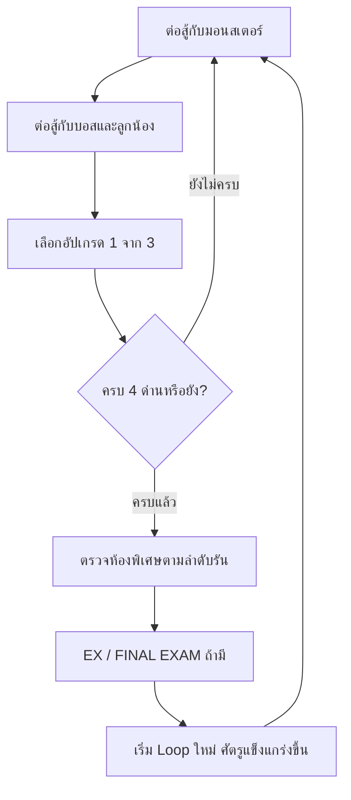

# มาทั้งที่ก็เป็นนักเรียนติดลูปไปซะได้

**Accepted into ISNE, yet stuck in a loop.**

เกมแอ็กชัน Roguelike มุมมอง 2D ที่เปลี่ยนชีวิตนักศึกษา ISNE ให้กลายเป็นการเอาชีวิตรอดในห้องเรียน ใช้สาย LAN และ Notebook ต่อสู้กับมอนสเตอร์ อาจารย์ และศัตรู EX เลือกอัปเกรดให้เข้ากับสไตล์การเล่น แล้วเผชิญปีการศึกษาที่วนกลับมาพร้อมความยากที่เพิ่มขึ้น

[เรื่องราว](#story) · [ตัวละครหลัก](#main-character) · [Game Loop](#gameplay-loop) · [วิธีเล่น](#how-to-play) · [ปุ่มควบคุม](#controls)

## Game Overview

| หัวข้อ | รายละเอียด |
| --- | --- |
| แนวเกม | Single-player · 2D Action Roguelike · Arena Combat |
| ธีม | ชีวิตนักศึกษา วิชาที่เรียน และการติดอยู่ในลูป |
| สถานที่ | อาคาร 30 ห้องเรียน ห้องปฏิบัติการ และห้อง Server |
| แพลตฟอร์มปัจจุบัน | PC / Windows ใช้คีย์บอร์ดและเมาส์ |
| เป้าหมาย | ผ่านห้องต่อสู้ สร้าง Build ด้วยอัปเกรด ชนะ EX และ FINAL EXAM แล้วเอาชีวิตรอดในลูปถัดไป |
| สถานะ | Playable Prototype — กำลังปรับสมดุลและงานภาพ |

**จุดเด่นของเกม**

- สลับอาวุธระยะใกล้และระยะไกล พร้อมบริหาร HP/SP ระหว่างต่อสู้
- อ่านวงเตือน หลบสกิล ใช้โต๊ะหรือ Ice Wall ช่วยจัดตำแหน่ง
- เลือกอัปเกรดหลังชนะบอส ทำให้แต่ละรันมี Build ต่างกัน
- EX แต่ละตัวมีกติกาเฉพาะ และ FINAL EXAM เปลี่ยนสนามเป็นการต่อสู้ที่เดินได้เฉพาะซ้าย–ขวา

## Story

> “I'm a student here.” 
> ผมเป็นนักเรียนที่นี่
>
> “I can't remember how many years I've been here...” 
> ผมจำไม่ได้แล้วว่าเรียนที่นี่มากี่ปี...
>
> “But I have this feeling...” 
> แต่ผมรู้สึกว่า...
>
> “I... must be stuck in a loop.” 
> ผม...ต้องติดอยู่ในลูปนี้แน่ ๆ

เรื่องเริ่มต้นที่อาคาร 30 สถานที่ที่ควรเป็นเพียงวันธรรมดาของนักศึกษา แต่ห้องเรียนกลับเต็มไปด้วยศัตรู และอาจารย์กลายเป็นบททดสอบที่ต้องผ่านไปให้ได้ เมื่อจบปีการศึกษา ทุกอย่างกลับเริ่มต้นอีกครั้งพร้อมความท้าทายที่มากกว่าเดิม

ผู้เล่นเลือกเดินเข้าประตูเพื่อเผชิญหน้ากับลูป หรือเดินไปที่รถเพื่อพบฉากจบทางเลือกแบบขำ ๆ

## Main Character

  

**นักศึกษา ISNE ผู้ติดอยู่ในลูป** คือคนที่ผู้เล่นควบคุมตลอดรัน ใช้อุปกรณ์ใกล้ตัวเป็นอาวุธ และเอาตัวรอดด้วยการเคลื่อนที่ หลบการโจมตี และเลือกจังหวะใช้สกิล

| สิ่งที่มีตอนเริ่มต่อสู้ | รายละเอียด |
| --- | --- |
| HP | 100 — หมดแล้วรันจบ |
| SP | 100 — ใช้กับการโจมตี Notebook, Dash และสกิลบางชนิด; ฟื้นตามเวลาและเมื่อกำจัดศัตรู |
| อาวุธ | LAN Cable และ Notebook สลับใช้ได้ทั้งสองแบบ |
| Potion | ยา HP 2 ขวด และยา SP 2 ขวด |

## Gameplay Loop

**Opening Story → หน้าปก → อาคาร 30 → ประตูห้องเรียน → เริ่มต่อสู้**

- **1 Loop มี 4 ด่าน** แต่ละด่านประกอบด้วยห้องมอนสเตอร์และห้องบอส ลำดับห้องเรียนและบอสถูกสลับในแต่ละลูป
- ห้องเรียนทั้งสี่คือ **Programming Lab, Circuit Workshop, Network Center และ Capstone Studio**
- ผ่านห้องมอนสเตอร์ฟื้น **12 HP**; ผ่านห้องบอสฟื้น **35 HP** และได้เลือกอัปเกรด
- **EX แรกอยู่หลัง Loop 1** จากนั้นพบอีกหลัง Loop 2, 4, 6, ... โดยสุ่มศัตรู EX หนึ่งตัว
- ชนะ **Ae และ Dome** ในรันเดียวกันเพื่อปลดล็อก **FINAL EXAM** หนึ่งครั้งต่อรัน ถ้ามี EX รออยู่ จะต่อสู้ EX ก่อนเข้าฉากคั่นของ FINAL EXAM
- ชนะ FINAL EXAM แล้วกลับไปเล่นตามลำดับรันต่อ เกมต้นแบบเน้นการเอาชีวิตรอดในลูปที่ยากขึ้น

**ผ่านห้อง:** กำจัดศัตรูที่เหลือทั้งหมด รวมลูกน้องของบอส 
**แพ้:** HP เหลือ 0 → GAME OVER → กด R เริ่มรันใหม่ อัปเกรดและรางวัลสะสมอยู่เฉพาะรันปัจจุบัน

## How to Play

### 1. เปิดเกมและเข้าสู่โรงเรียน

สำหรับแพ็กเกม Windows ให้แตกไฟล์ ZIP แล้วเปิด **START_GAME.bat** โดยเครื่องต้องมี Java 17 หรือใหม่กว่า

1. เมื่อเปิดเกมครั้งแรกจะพบ Story ภาษาอังกฤษและไทยบนฉากดำ ปล่อยให้เล่นอัตโนมัติ หรือกด **Enter / Space / คลิกซ้าย** เพื่อเลื่อนข้อความ และกด **Esc** เพื่อข้าม
2. ที่หน้าปก คลิก **START** หรือกด **Enter** เพื่อเข้าอาคาร 30
3. ใช้ **WASD / ปุ่มลูกศร** เดินไปประตูด้านซ้ายเพื่อเริ่มต่อสู้
4. ถ้าอยากสำรวจทางเลือก เดินเข้าใกล้รถแล้วกด **E** หรือคลิกที่รถ เลือกกลับบ้านหรือกลับไปเผชิญหน้ากับโรงเรียน

### 2. เอาชีวิตรอดในห้องต่อสู้

1. คลิกใกล้ศัตรูเพื่อเลือกเป้า แล้ว **กดคลิกซ้ายค้าง / Space** เพื่อโจมตี กรอบสีเขียวแสดงเป้าหมายที่ล็อกอยู่
2. ใช้ **Tab** สลับอาวุธ: **LAN** เหมาะกับระยะใกล้และไม่เสีย SP ส่วน **Notebook** โจมตีระยะไกลและติดตามเป้าหมาย แต่ใช้ SP
3. ขยับออกจากวงหรือแนวเตือนก่อนการโจมตีลงถึงตัว ใช้ **Shift** เพื่อ Dash เมื่อจำเป็น
4. ใช้ **E — PowerBall**, **F — Ice Wall** และ **R — Sword Wave** ตามสถานการณ์ โดย Sword Wave ต้องถือ LAN
5. ดูแถบ HP/SP และจำนวน Potion ด้านบน กด **Z** เติม HP หรือ **X** เติม SP ก่อนทรัพยากรหมด
6. กำจัดศัตรูให้ครบห้อง แล้วกด **Enter** เพื่อไปต่อ หลังชนะบอสให้เลือกอัปเกรดหนึ่งอย่าง

### 3. สร้าง Build และผ่านห้องพิเศษ

- หลังชนะบอส เลือกอัปเกรดจากสามตัวเลือกด้วยเมาส์หรือปุ่ม **1 / 2 / 3** กด **R** เพื่อสุ่มตัวเลือกใหม่ได้หนึ่งครั้งต่อหน้ารางวัล
- เลือกเพิ่มดาเมจ ความเร็วโจมตี ความเร็วเดิน หรือเอฟเฟกต์อย่าง Slow, Poison และ Splash ให้เข้ากับอาวุธที่ใช้
- ในห้อง EX จะได้ใช้ **LAN Tether** และ **Notebook Heat Beam** ชั่วคราว ส่วนรางวัลจากการชนะ EX อยู่ต่อจนจบรัน
- ใน FINAL EXAM ผู้เล่นอยู่เลนล่างและเดิน/Dash ได้เฉพาะ **ซ้าย–ขวา** ใช้การโจมตีระยะไกลขึ้นไปหาบอสบนตู้ Server พร้อมหลบสกิลของทั้งสองตัว

## Controls

| การกระทำ | ปุ่ม |
| --- | --- |
| เลื่อน Story / ข้าม Story | Enter, Space หรือคลิกซ้าย / Esc |
| เริ่มเกมที่หน้าปก | คลิก START หรือ Enter |
| เดิน | WASD หรือปุ่มลูกศร; FINAL EXAM ใช้เฉพาะซ้าย–ขวา |
| โจมตีปกติ | คลิกซ้ายค้าง หรือ Space |
| ล็อกเป้า | คลิกใกล้ศัตรู; คลิกพื้นว่างจะเลือกศัตรูที่ใกล้ผู้เล่นที่สุด |
| สลับอาวุธ | Tab หรือ 1 = LAN, 2 = Notebook |
| Dash | Shift |
| PowerBall | E หรือปุ่ม BALL บนจอ |
| Ice Wall | F หรือปุ่ม ICE บนจอ |
| LAN Sword Wave | R หรือปุ่ม LAN บนจอ เมื่อถือ LAN |
| ใช้ยา HP / SP | Z / X |
| หลุดจาก Bind | กด A–D หรือซ้าย–ขวาสลับกัน 6 ครั้ง |
| เลือกอัปเกรด | คลิกตัวเลือก หรือ 1 / 2 / 3 |
| สุ่มอัปเกรดใหม่ | R — หนึ่งครั้งต่อหน้ารางวัล |
| ไปห้องถัดไป / เริ่ม FINAL EXAM | Enter |
| เริ่มรันใหม่หลังแพ้ | R |

**ปุ่ม R เปลี่ยนหน้าที่ตามหน้าจอ:** ระหว่างต่อสู้คือ Sword Wave, หน้ารางวัลคือสุ่มอัปเกรด และหน้า GAME OVER คือเริ่มใหม่

## Weapons & Skills

| อาวุธ / สกิล | การใช้งาน | ค่าใช้จ่ายพื้นฐาน |
| --- | --- | --- |
| LAN Cable | ฟาดเป็นวงด้านหน้า เหมาะกับศัตรูระยะใกล้ | ไม่เสีย SP |
| Notebook | ขว้างโจมตีจากระยะไกล กระสุนติดตามเป้าหมาย | 10 SP ต่อครั้ง |
| Sword Wave | ปล่อยคลื่นตรงไปตามเป้าหรือทิศที่หัน เมื่อถือ LAN | ไม่เสีย SP |
| PowerBall | ลูกพลังติดตามเป้า ระเบิดเป็นวงและผลักศัตรู; ยืนร่ายก่อนปล่อย | 30 SP |
| Ice Wall | วางกำแพงด้านหน้า ตำแหน่งคงที่ 4.5 วินาที กั้นการเดินและกระสุนศัตรู | 25 SP |
| Dash | พุ่งเปลี่ยนตำแหน่ง พร้อมช่วงป้องกันดาเมจสั้น ๆ | 25 SP |

**Potion:** ยา HP ฟื้น **40 HP** และยา SP ฟื้น **35 SP** ขวดที่เหลือเก็บข้ามห้องได้ การกดใช้ขณะค่าพลังเต็มจะไม่เสียขวด

## Enemies & Bosses

### มอนสเตอร์ปกติ

| ประเภท | สิ่งที่ต้องรับมือ |
| --- | --- |
| Basic | เข้าประชิดและโจมตี |
| Ranged | รักษาระยะแล้วปล่อยกระสุน |
| Wave | ยิงคลื่นพลังเข้าหาผู้เล่น |
| Shielded | มีเกราะ ต้องทำลายเกราะก่อนลด HP |
| Binder | กระสุนจับผู้เล่นให้อยู่กับที่ |
| Warper | เตือนจุดก่อนวาร์ปเข้ามาโจมตี |

### บอสอาจารย์

มีบอสปกติ **5 ตัว** แต่ละลูปพบ 4 ตัว: **Ken หรือ Sati** ร่วมกับ **Ae, M และ Dome**

| บอส | รูปแบบการต่อสู้ |
| --- | --- |
| Ajarn Ken | วางระเบิดหลายจุดพร้อมวงเตือน และเรียกลูกน้อง |
| Ajarn Sati | ธาตุ C++ แปลงเป็นหอก และเรียกลูกน้องมีเกราะ |
| Ajarn Ae | วาร์ป โจมตีจับ/ทำดาเมจ และเลเซอร์กวาดในห้องปกติ |
| Ajarn M | แยกร่างเมื่อ HP เหลือครึ่งหนึ่ง ต้องรับมือกระสุนจากทั้งสองร่าง |
| Ajarn Dome | สายฟ้าเตือนจุดก่อนฟาด สลับกับเลเซอร์ชาร์จก่อนยิง |

### EX Encounters

| EX | กติกาพิเศษ | รางวัล |
| --- | --- | --- |
| Liquid Cat | เฟสแรกอยู่นิ่ง เมื่อถูกกำจัดจะแปลงเป็นเฟสสองที่เคลื่อนที่ แยกร่าง และใช้ Orbital จากฟ้า | Max HP +25 และฟื้น 45 HP |
| Allergic Vacuum | ดูดฝุ่นและดึงผู้เล่นเข้าใกล้ เมื่อค่าแพ้เต็มจะเตือนก่อนจามฝุ่นออกมา | ความเร็วเดิน +30 และฟื้น 20 HP |
| Insecure Sword | เดินเก็บ Post-it แล้วนำเข้าใกล้บอสเพื่อลดเกราะ แต่ทำให้มันมั่นใจขึ้น; ฉวยจังหวะตอนฟันพลาด | ดาเมจ LAN +8, Notebook +6 และฟื้น 20 HP |

### FINAL EXAM — Ae & Dome

เมื่อชนะ Ae และ Dome ครบในรันเดียวกัน จะเปิดห้องพิเศษที่ทั้งสองอยู่บนตู้ Server ด้านบน ผู้เล่นเดินขึ้นไปไม่ได้และต้องรับมือการโจมตีพร้อมกันจากเลนด้านล่าง โดยเลเซอร์ของ Dome ยิงลงจากตู้

## Gameplay Screenshots

### ห้องต่อสู้และสิ่งกีดขวาง

### FINAL EXAM

## Survival Tips

- **อย่าใช้ SP จนหมด:** เก็บไว้สำหรับ Dash หรือ Ice Wall และใช้ LAN ระหว่างรอฟื้นพลัง
- **อ่านวงเตือนก่อนโจมตี:** ย้ายออกจากจุดเป้าหมายก่อนสายฟ้า ระเบิด หรือ Orbital ลงถึงพื้น
- **ใช้โต๊ะให้ถูกจังหวะ:** โต๊ะขวางการเดินและกระสุนทั่วไป แต่กระสุนบอสข้ามโต๊ะได้ ส่วน Ice Wall กันกระสุนศัตรูรวมถึงบอส
- **จัดการลูกน้องด้วย:** ห้องบอสจะผ่านเมื่อกำจัดศัตรูที่เหลือครบ ไม่ใช่แค่ลด HP บอสหมด
- **อย่าลืม Potion:** ขวดมีจำกัด เลือกใช้ตอนที่ได้ประโยชน์จากการฟื้นพลังเต็มจำนวน

## Project Status

เกมอยู่ในช่วงต้นแบบที่เล่นได้ มีโหมดผู้เล่นคนเดียว ห้องเรียน 4 ด่าน บอสปกติ 5 ตัว EX 3 ตัว และ FINAL EXAM การเลือกอัปเกรดกับรางวัล EX ช่วยให้ Build เติบโตตลอดรัน หลังจบลูปศัตรูจะมี HP, SP, ดาเมจ และความเร็วเพิ่มขึ้น

งานที่กำลังพัฒนาต่อคือความสมดุล ความชัดเจนของการโจมตี งานภาพ และคำแนะนำสำหรับผู้เล่นใหม่

อ่านรายละเอียดการออกแบบเพิ่มเติมใน [Game Design Document](GDD.md)

---

โปรเจกต์เกมนักศึกษา ISNE · สปินออฟธีมนักศึกษาจาก **Pusenbi** · พัฒนาด้วย **Java และ libGDX** · ภาพประกอบแสดงเกมต้นแบบปัจจุบัน
