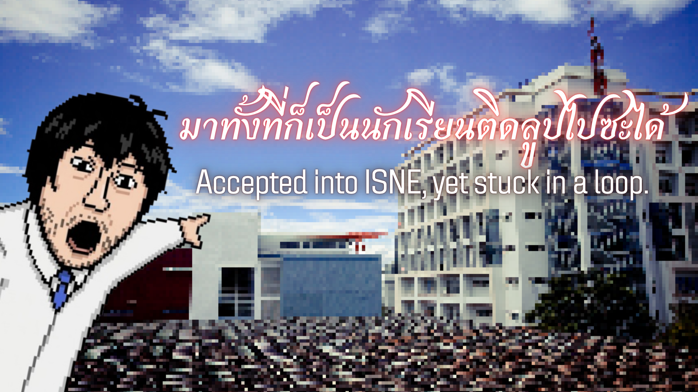
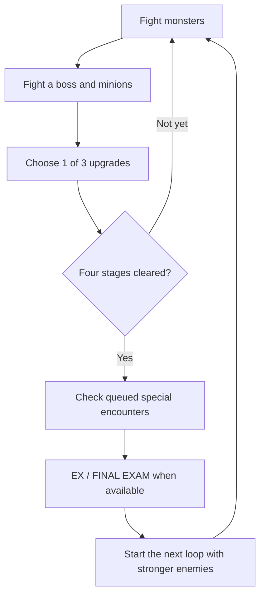
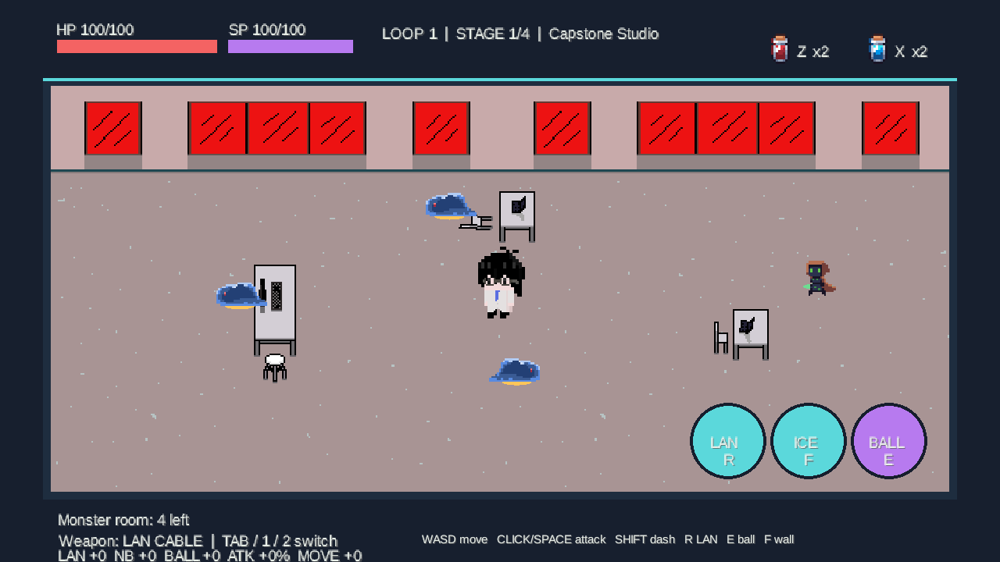
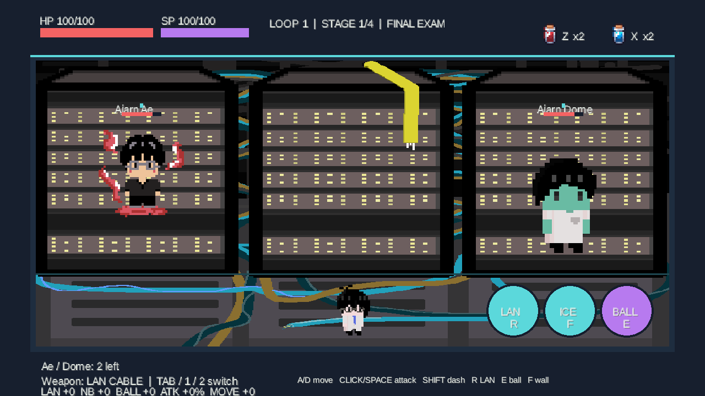

# มาทั้งที่ก็เป็นนักเรียนติดลูปไปซะได้

**Accepted into ISNE, yet stuck in a loop.**

A 2D action roguelike that turns ISNE student life into a fight for survival. Battle monsters, teachers, and EX enemies with a LAN cable and a notebook. Choose upgrades that fit your playstyle, then face another school year as the loop repeats with stronger enemies.

[Story](#story) · [Main Character](#main-character) · [Game Loop](#gameplay-loop) · [How to Play](#how-to-play) · [Controls](#controls)

## Game Overview

| Category | Description |
| --- | --- |
| Genre | Single-player · 2D Action Roguelike · Arena Combat |
| Theme | Student life, academic subjects, and being trapped in a loop |
| Setting | Building 30, classrooms, laboratories, and a server room |
| Current Platform | PC / Windows, with keyboard and mouse controls |
| Objective | Clear combat rooms, build your character through upgrades, defeat EX enemies and the FINAL EXAM, and survive the next loop |
| Status | Playable prototype, with balancing and visual polish in progress |

**Game Highlights**

- Switch between melee and ranged weapons while managing HP and SP.
- Read attack warnings, dodge skills, and use tables or Ice Wall to control your position.
- Choose upgrades after boss fights to create a different build each run.
- Face unique EX mechanics and a FINAL EXAM where movement is limited to left and right.

## Story

> “I'm a student here.”
>
> “I can't remember how many years I've been here...”
>
> “But I have this feeling...”
>
> “I... must be stuck in a loop.”

The story begins at Building 30. What should have been an ordinary school day becomes a series of classrooms filled with enemies, with teachers standing between you and the next stage. When the school year ends, everything starts again with a greater challenge.

Walk through the classroom door to face the loop, or approach the car to discover a humorous alternative ending.

## Main Character

  

Play as **an ISNE student trapped in a loop**. Turn everyday equipment into weapons and survive through movement, dodging, and well-timed skills.

| Starting Resource | Details |
| --- | --- |
| HP | 100 — reaching zero ends the run |
| SP | 100 — spent on Notebook attacks, Dash, and certain skills; recovers over time and when enemies are defeated |
| Weapons | LAN Cable and Notebook, both available when combat begins |
| Potions | 2 HP potions and 2 SP potions |

## Gameplay Loop

**Opening Story → Title Screen → Building 30 → Classroom Door → Combat**

- **Each loop has four stages.** Every stage contains a monster room and a boss room. Classroom and boss order are shuffled each loop.
- The four classrooms are **Programming Lab, Circuit Workshop, Network Center, and Capstone Studio**.
- Clearing a monster room restores **12 HP**. Clearing a boss room restores **35 HP** and grants an upgrade choice.
- **The first EX encounter follows Loop 1.** Further EX encounters appear after Loops 2, 4, 6, and so on, with one randomly selected EX enemy.
- Defeat **Ae and Dome** in the same run to unlock the **FINAL EXAM** once per run. If an EX encounter is queued, it takes place before the FINAL EXAM cutscene.
- After the FINAL EXAM, the run continues. The prototype focuses on surviving increasingly difficult loops.

**Room Clear:** Defeat every remaining enemy, including boss minions. 
**Defeat:** HP reaches 0 → GAME OVER → Press R to start a new run. Upgrades and earned rewards last only for the current run.

## How to Play

### 1. Launch the Game and Enter School

For the Windows game package, extract the ZIP and open **START_GAME.bat**. Java 17 or later is required.

1. On the first launch, a short English and Thai story appears on a black screen. Let it advance automatically, press **Enter / Space / left-click** to advance, or press **Esc** to skip.
2. On the title screen, click **START** or press **Enter** to enter Building 30.
3. Use **WASD / arrow keys** to reach the door on the left and begin combat.
4. To explore the alternative ending, approach the car and press **E** or click it. Choose whether to go home or return to school.

### 2. Survive Combat Rooms

1. Click near an enemy to select a target, then **hold the left mouse button / Space** to attack. A green outline marks the locked target.
2. Press **Tab** to switch weapons. **LAN** is suited to melee combat and costs no SP. **Notebook** fires homing ranged attacks that consume SP.
3. Move out of warning circles and lines before attacks land. Use **Shift** to Dash when needed.
4. Use **E — PowerBall**, **F — Ice Wall**, and **R — Sword Wave** as the situation demands. Sword Wave requires LAN to be equipped.
5. Watch the HP/SP bars and potion counts at the top of the screen. Press **Z** to restore HP or **X** to restore SP.
6. Defeat every enemy, then press **Enter** to continue. After a boss fight, choose one upgrade.

### 3. Build Your Character and Clear Special Encounters

- After defeating a boss, choose one of three upgrades with the mouse or **1 / 2 / 3**. Press **R** to reroll once per reward screen.
- Improve damage, attack speed, movement speed, or effects such as Slow, Poison, and Splash to support your preferred weapon.
- EX rooms temporarily provide **LAN Tether** and **Notebook Heat Beam**. Rewards earned by defeating an EX enemy remain until the run ends.
- During the FINAL EXAM, movement and Dash are restricted to **left and right** in the lower lane. Use ranged attacks against the bosses on the server cabinets while dodging both bosses' skills.

## Controls

| Action | Input |
| --- | --- |
| Advance Story / Skip Story | Enter, Space, or left-click / Esc |
| Start from the Title Screen | Click START or press Enter |
| Move | WASD or arrow keys; left and right only during the FINAL EXAM |
| Normal Attack | Hold the left mouse button or Space |
| Lock Target | Click near an enemy; clicking empty ground selects the enemy nearest to the player |
| Switch Weapon | Tab, or 1 = LAN and 2 = Notebook |
| Dash | Shift |
| PowerBall | E or the on-screen BALL button |
| Ice Wall | F or the on-screen ICE button |
| LAN Sword Wave | R or the on-screen LAN button, with LAN equipped |
| Use HP / SP Potion | Z / X |
| Escape Bind | Alternate A–D or Left–Right six times |
| Choose Upgrade | Click an option or press 1 / 2 / 3 |
| Reroll Upgrades | R — once per reward screen |
| Continue to the Next Room / Start the FINAL EXAM | Enter |
| Start a New Run After Defeat | R |

**R changes function by screen:** Sword Wave during combat, reroll on the reward screen, and restart on GAME OVER.

## Weapons & Skills

| Weapon / Skill | Function | Base Cost |
| --- | --- | --- |
| LAN Cable | Swing in a forward arc to hit nearby enemies | No SP cost |
| Notebook | Throw homing projectiles at distant targets | 10 SP per attack |
| Sword Wave | Send a straight wave toward the target or facing direction, with LAN equipped | No SP cost |
| PowerBall | Launch a homing energy ball that explodes in an area and pushes enemies; stand still to cast | 30 SP |
| Ice Wall | Place a wall in a fixed position ahead for 4.5 seconds; blocks movement and enemy projectiles | 25 SP |
| Dash | Reposition quickly with brief invulnerability | 25 SP |

**Potions:** HP potions restore **40 HP**, and SP potions restore **35 SP**. Unused bottles carry over between rooms. Using a potion while its resource is full does not consume a bottle.

## Enemies & Bosses

### Regular Monsters

| Type | Behavior |
| --- | --- |
| Basic | Approaches the player and attacks at close range |
| Ranged | Keeps its distance and fires projectiles |
| Wave | Fires energy waves toward the player |
| Shielded | Has armor that must be broken before its HP can be reduced |
| Binder | Fires projectiles that temporarily immobilize the player |
| Warper | Marks an attack location before teleporting in to strike |

### Teacher Bosses

There are **five regular bosses**. Each loop includes four: **Ken or Sati**, together with **Ae, M, and Dome**.

| Boss | Combat Pattern |
| --- | --- |
| Ajarn Ken | Places bombs at multiple marked locations and summons minions |
| Ajarn Sati | Transforms C++ elements into spears and summons armored minions |
| Ajarn Ae | Teleports, binds or damages the player, and uses sweeping lasers in regular boss rooms |
| Ajarn M | Splits into two bodies at half HP, forcing the player to dodge projectiles from both |
| Ajarn Dome | Alternates marked lightning strikes with lasers that charge before firing |

### EX Encounters

| EX Enemy | Special Mechanics | Reward |
| --- | --- | --- |
| Liquid Cat | Remains stationary in phase one; taking lethal damage triggers a mobile second phase with copies and fast Orbital strikes from the sky | Max HP +25 and restore 45 HP |
| Allergic Vacuum | Sucks in dust and pulls the player closer; a full allergy meter triggers a warning followed by a dusty sneeze | Movement speed +30 and restore 20 HP |
| Insecure Sword | Collect Post-it notes and bring them near the boss to reduce its armor while raising its confidence; attack when it misses a swing | LAN damage +8, Notebook damage +6, and restore 20 HP |

### FINAL EXAM — Ae & Dome

Defeating Ae and Dome in the same run unlocks a special room where both bosses stand on the upper server cabinets. The player cannot move up to them and must face their combined attacks from the lower lane. Dome's lasers fire downward from the cabinet.

## Gameplay Screenshots

### Combat Rooms and Obstacles

### FINAL EXAM

## Survival Tips

- **Keep some SP in reserve.** Save it for Dash or Ice Wall, and use LAN while SP recovers.
- **Watch attack warnings.** Leave marked areas before lightning, bombs, or Orbital strikes land.
- **Use cover carefully.** Tables block movement and ordinary projectiles, but boss projectiles can pass over them. Ice Wall blocks enemy projectiles, including boss shots.
- **Clear the minions too.** Boss rooms finish only when all remaining enemies have been defeated.
- **Make potions count.** Bottles are limited, so use them when you can benefit from the full amount restored.

## Project Status

The playable prototype includes single-player combat, four classroom stages, five regular bosses, three EX enemies, and the FINAL EXAM. Upgrades and EX rewards develop your build throughout a run. Enemy HP, SP, damage, and speed increase with each completed loop.

Ongoing work focuses on balancing, attack readability, visual polish, and guidance for new players.

Read more in the [Game Design Document](GDD.md).

---

An ISNE student game project · A student-themed spin-off of **Pusenbi** · Built with **Java and libGDX** · Screenshots show the current playable prototype.
